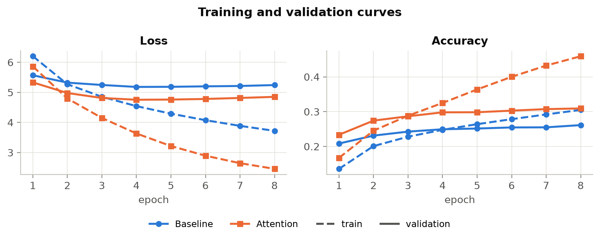
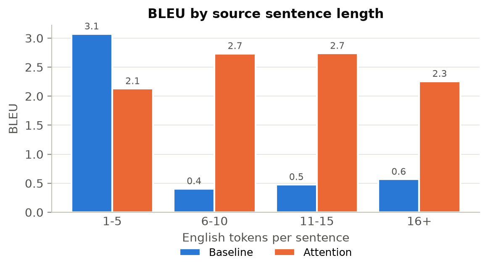

# Q1: English-to-Hindi NMT, LSTM encoder-decoder with and without attention

Owner: Rishi Kharya. Code in this folder, all numbers below come from `outputs/results/`, all figures from `outputs/figures/`. One seed (42) for each model; no confidence intervals.

## 1. Data preparation

IIT Bombay English-Hindi corpus (HuggingFace `cfilt/iitb-english-hindi`): official train / dev / test splits.

| | |
|---|---|
| Training pairs used | **50,000** (random draw from 1,659,083 raw pairs, seed 42) |
| Dev / test pairs | 514 / 2,393 (official splits, cleaned) |
| English vocabulary | **21,433** (training only, `min_freq=2`, incl. 4 special tokens) |
| Hindi vocabulary | **24,274** |
| Max English length / max Hindi length | **50 / 50** tokens (hard filter, `<sos>`/`<eos>` add 2 when padded) |
| Mean length, train (en / hi) | 17.7 / 18.4 tokens |
| Mean length, test (en / hi) | 21.0 / 23.6 tokens |
| OOV rate on test (en / hi) | 8.4% / 8.0% |

Steps: NFC normalisation, English lower-cased, punctuation (including the Hindi danda) split into its own token, whitespace tokenisation, `<sos>`/`<eos>` added, vocabulary to IDs (`<pad>=0, <unk>=1, <sos>=2, <eos>=3`), right-padding per batch.

Dropped as malformed: empty sides; either side outside 1 to 50 tokens; no Latin letter on the English side or no Devanagari on the Hindi side; and, for training only, a length ratio above 3. Training pairs also need at least 5 English tokens, because the corpus contains many one-word UI strings while the dev/test news sentences are long. Dev and test are not length-filtered beyond the 50-token cap.

**Test set is long.** 1,617 of 2,393 test sentences (68%) have 16 or more English tokens, 481 have 11 to 15, 282 have 6 to 10 and only 13 have 1 to 5. The 1-5 bucket is far too small to draw conclusions from.

## 2. Models

Both share the same encoder: 2-layer bidirectional LSTM (embedding 256, hidden 512, dropout 0.3), run on packed sequences so padding never enters the recurrence. Teacher forcing in training, greedy decoding at test time.

* **Model A (baseline).** The encoder's final states (both directions merged and projected) initialise a 2-layer LSTM decoder. That vector is the only information the decoder gets about the source. Dense + softmax output. 38.3M parameters.
* **Model B (attention).** All encoder states h1..hn are kept. At each step, `e_t,i = vᵀ tanh(W_s s_{t-1} + W_h h_i)`, `α = softmax(e)` (padding masked), `c_t = Σ α_i h_i`. The context is concatenated to the decoder input and to the pre-softmax features. Our own implementation (`models.py`, `BahdanauAttention`); α is returned at every step for the heatmaps. 71.9M parameters.

Comparable conditions: same data, vocabularies, seed, optimiser (Adam, 1e-3, gradient clip 1.0), batch size 64, early stopping on validation loss (patience 4, best epoch restored). The models do **not** have equal parameter counts, because attention adds the score network and a wider output layer.

**Metrics.** BLEU (sacreBLEU, corpus level, default `13a`) and chrF as translation metrics; masked token accuracy (teacher-forced next-token accuracy) for training curves. The brief names no translation metric, so this is our choice.

**Decoding detail.** `<unk>` is the most probable single target token (about 1 in 12 target words is out of vocabulary), so unconstrained greedy decoding collapsed into `<unk> <unk> …` and the first evaluation gave empty outputs. Both models now decode with `<pad>`, `<unk>` and `<sos>` banned. This applies equally to A and B.

## 3. Training and comparison



| | Best epoch | Val loss | Val acc | Test loss | Test token acc | **Test BLEU** | **Test chrF** | s/epoch |
|---|---|---|---|---|---|---|---|---|
| A: baseline | 4 | 5.180 | 0.249 | 5.078 | 0.243 | **0.55** | 12.3 | 48 |
| B: attention | 4 | 4.754 | 0.298 | 4.665 | 0.290 | **2.34** | 17.9 | 222 |

BLEU n-gram precisions (1 to 4): A 15.9 / 2.2 / 0.2 / 0.0, B 24.0 / 5.3 / 1.1 / 0.2. Brevity penalty 1.0 for both (outputs slightly longer than references).

Attention is better on every measure and for every epoch of validation loss. Both models overfit quickly: training accuracy keeps rising (A 0.31, B 0.46 at epoch 8) while validation loss turns upward after epoch 4. With 50k pairs and about 70M parameters this is expected. The absolute BLEU is low for both: this is a word-level LSTM trained on a small slice of a mixed-domain corpus and tested on long news sentences. The size of the gap matters more than the absolute value, and BLEU of 0.55 means the baseline is barely translating at all.

Run history: a first run with 30,000 pairs (no minimum length) gave BLEU 0.02 / 1.21 for A / B with the same ordering; its numbers are kept in `outputs/results/archive_run1_30k/`.

## 4. Baseline limitation

A single fixed-size vector has to carry the content, the word order and the length of the whole input. The longer the input, the more information has to be squeezed into the same 512 numbers.



| English length | n | A: BLEU / chrF | B: BLEU / chrF |
|---|---|---|---|
| 1-5 | 13 | 3.07 / 7.6 | 2.13 / 12.8 |
| 6-10 | 282 | 0.41 / 9.0 | 2.73 / 16.0 |
| 11-15 | 481 | 0.48 / 10.7 | 2.74 / 17.1 |
| 16+ | 1617 | 0.57 / 12.7 | 2.26 / 18.2 |

What the data does and does not show:

* **Short vs long.** We cannot show a clean decline with length for the baseline: its BLEU is near zero in every bucket (0.4 to 0.6 for 6 or more tokens), so there is nothing left to lose. Its chrF actually rises with length (7.6 to 12.7), because long sentences contain many frequent function words that even a content-blind model gets right. The 1-5 BLEU of 3.07 for A beats B, but it rests on 13 sentences and should not be read as a result.
* **Does the baseline use the source at all?** Its outputs for different inputs are very similar generic sentences ("एक दूसरे के साथ एक दूसरे से अधिक है", error cases 1, 4, 7). Its unigram precision is 15.9% against 24.0% for attention. We did not run a no-source ablation, so we cannot say how much of the baseline's output is truly input-independent, but for these long sentences the fixed vector clearly carries little usable content.
* **Do early words get lost?** Unigram recall of reference words by position in the reference, for sentences with 16 or more English tokens (`position_recall.png`):

  | Reference quarter | Q1 | Q2 | Q3 | Q4 |
  |---|---|---|---|---|
  | Baseline | 0.16 | 0.15 | 0.13 | 0.22 |
  | Attention | 0.28 | 0.25 | 0.23 | 0.28 |

  The baseline is poor in all positions and worst in the middle. We do **not** see the "early words are forgotten" pattern as a distinct effect. The last quarter is best for both models, probably because it holds the frequent closing words ("है", "।"). Attention improves recall in every quarter, most in the first.

## 5. Attention behaviour

Heatmaps: x = English tokens (with `<sos>`/`<eos>`), y = generated Hindi tokens. Eleven examples spread over the length buckets are in `outputs/figures/attention_heatmap_*.png` (list with the translations in `heatmap_examples.json`). Statistics over all 2,393 test sentences (`attention_behaviour.json`):

* **Mostly sequential.** In 85% of steps the attention peak stays or moves forward in the source. Hindi is SOV, English SVO, so verbs and objects swap places; this shows as off-diagonal blocks (e.g. error case 5, where "sent" is attended at the end for "भेजा गया है").
* **Sharp for content words, diffuse otherwise.** One-to-one cases are sharp: "congress" gets weight about 0.9 for "कांग्रेस" (`attention_heatmap_01.png`), "both" about 0.85 for "दोनों" (error case 6). On average the peak is only 0.28 and the entropy 2.3 nats, close to spreading over about 10 words.
* **Multi-word attention.** In 21% of steps no word gets 0.5 but two or more get above 0.2: function words and phrases such as "would be used", "of the", "not only" are spread over several source tokens.
* **`<sos>`/`<eos>` get only 1%** of the mass, so the model does not use them as "no-op" sinks.
* **Does a high weight mean a correct word? No.** The mean peak weight for generated tokens that occur in the reference is 0.2769, for tokens that do not 0.2768, identical. In error case 4 "abroad" receives the highest weight of the sentence (about 0.65) for three consecutive steps and the model writes "भी भी भी". In case 6 the alignment looks like a good translation while "dancers" becomes "संगीत".

## 6. Error analysis

Eight test sentences where the attention model is wrong or partly wrong (sentence chrF between 22 and 55), chosen to cover different error types; figures `error_case_01.png` to `error_case_08.png`, full table with all columns in `outputs/results/error_cases.md`. Types: missing / extra / wrong word, word order, long-distance dependency, OOV, wrong attention focus.

| # | English | Reference | Baseline | Attention | Manual error type |
|---|---|---|---|---|---|
| 4 (#2031) | his name became known not only in the country , but also abroad . | उनका नाम देश ही नहीं बल्कि विदेशों में भी प्रसिद्ध हुआ । | वह अपने पिता के साथ एक दूसरे से बाहर नहीं थे । | उनका नाम केवल देश में ही नहीं बल्कि बल्कि भी भी भी थीं । | wrong / missing word (विदेशों), repetition; **high weight, wrong output** |
| 3 (#1127) | $325m rescue package for tassie health | टैजी के स्वास्थ्य के लिए 325 मिलियन डॉलर का बचाव पैकेज | एक नया स्रोत जिसमें एक नया | स्वास्थ्य के लिए माइक्रोसॉफ़्ट अनुरोध | OOV (tassie), missing number, wrong word |
| 6 (#2388) | it is noteworthy that both nita and isha are professional , classical dancers . | गौरतलब है कि नीता और ईशा दोनों ही प्रोफेशनल क्लासिकल डांसर है । | यह एक बड़ी बात है कि यह एक बड़ी बात है कि एक दूसरे के लिए एक बड़ी समस्या है । | यह जानकर प्रसन्नता है कि दोनों और दोनों ही शैली में हैं , और शास्त्रीय संगीत हैं । | OOV names dropped, wrong words with correct-looking alignment |
| 2 (#799) | afterwards , there would be a joint presentation by the bcci and the mca . | इसके बाद बीसीसीआइ और एमसीए द्वारा संयुक्त प्रस्तुतिकरण होगा । | एक बार फिर से एक दूसरे के लिए एक दूसरे से एक दूसरे के साथ एक दूसरे से बाहर हो गया है । | इसके अतिरिक़्त , और और इस द्वारा द्वारा एक ही एक ही एक ही होगा । | OOV (bcci, mca), extra / repeated words; correct focus on "joint presentation" |
| 5 (#2278) | according to amarnath upadhyaya , secretary of ada , a proposal concerning this matter has been sent to the government . | एडीए के सचिव अमरनाथ उपाध्याय के मुताबिक इस बाबत शासन को प्रस्ताव भेजा जा चुका है । | इस प्रकार के दौरान , इस क्षेत्र में एक बड़ी संख्या में एक बड़ी भूमिका है । | इस बात के अनुसार , श्री एक समिति के अनुसार , इस अध्याय को इस सरकार को इस बैठक में भेजा गया है । | OOV names → generic words, wrong words ("बैठक"), extra words; good alignment at the end |
| 7 (#800) | besides that , a special coin would be used for the coin toss that would be kept by the mca . | इसके अलावा टॉस के लिए एक विशेष सिक्के का इस्तेमाल किया जाएगा जिसे एमसीए संभालकर रखेगा । | यह एक बड़ी बात है कि यह एक बड़ी बात है जो एक दूसरे के साथ एक दूसरे से अधिक है । | इसके अलावा , एक विशेष रूप से एक विशेष रूप से प्रयोग किया जाएगा , जो कि वह इस प्रकार के द्वारा किया जाएगा कि वह द्वारा स्वंय के द्वारा किया जाएगा . | repetition, missing content (टॉस, सिक्के, एमसीए), long-distance dependency |
| 1 (#2171) | " i'm not sure when he sleeps , " said katie o'malley , a second-year medical student from drexel university … | … कैटी ओ'मैली ने कहा , " मुझे नहीं पता कि वे सोते कब हैं । " | ( ऐ रसूल ) तुम कह दो कि … | " जब उन्होंने कहा कि जब उन्होंने कहा कि " आचार्य , " आचार्य , श्री राम नाथ कोविन्द से पूर्व मुख्यमंत्री … | long-distance dependency, **wrong attention focus** (stuck on one word for 12 steps), hallucination, OOV names |
| 8 (#1568) | " our ongoing inquiry into this matter continues and we are co-operating fully with the fca … , " the bank said two weeks ago . | दो सप्ताह पहले बैंक ने कहा था कि , " इस मामले में … सहयोग कर रहे हैं । " | मैं इस अवसर पर आपके लिए बधाई देता हूं कि … | हमारे इस क्षेत्र में हम इस तरह के साथ … ‘ ‘ द ’ ’ ’ ’ के साथ ही हम दोनों को भी कहा जाता है । | long-distance dependency, word order, **wrong attention focus** (anchored on punctuation) |

Patterns across the eight cases and the aggregate statistics:

1. **OOV words** (names, acronyms: 8% of test tokens) are the single biggest cause. They are dropped or replaced by generic words in 7 of 8 cases. Attention cannot translate a word that is not in the output vocabulary.
2. **Repetition** appears in 5 of 8 cases and in 17.6% of the long sentences (baseline: 0.5%). Attention gives the decoder more content to say but nothing stops it from saying the same thing again; there is no coverage mechanism.
3. **Long inputs still hurt.** In cases 1, 7 and 8 the first half is translated sensibly and the diagonal breaks in the second half; attention gets stuck on one source word or on punctuation.
4. **Right focus, wrong word** is common (cases 2, 3, 4, 6): attention sits on the correct source words but the decoder's lexical choice fails, which is a vocabulary/data-size problem, not an alignment problem.
5. **Is the heatmap a useful explanation?** It is useful for *locating* a failure (stuck column in case 1, broken diagonal in case 7, punctuation anchoring in case 8) and for confirming alignment of content words. It is not a guarantee of correctness: weights do not separate right words from wrong ones (section 5), and in cases 4 and 6 the heatmap looks like a good translation of a wrong output.

## 7. Final comparison

* **Does attention improve NMT?** Yes, clearly, with one seed and low absolute scores: BLEU 0.55 → 2.34 (4.3×), chrF 12.3 → 17.9, token accuracy 0.243 → 0.290, validation loss 5.18 → 4.75. The same ordering held in the earlier 30k-pair run.
* **Short vs long.** For 6 or more tokens attention is 4 to 7 times better in BLEU, and its BLEU stays flat (2.3 to 2.7) from 6-10 to 16+, while the baseline stays at the floor. The 1-5 bucket (13 sentences) gives no usable comparison.
* **Which errors went away.** The fully generic, source-independent outputs of the baseline are mostly gone: attention outputs mention the right topic words (e.g. "बाजार", "केंद्रीय", "सरकार", "भेजा गया"), keep sentence openings ("इसके अलावा") and many content words aligned.
* **Which errors remain or got worse.** OOV words, long-distance structure, and repetition (17.6% of long outputs against 0.5%).
* **What the heatmaps show.** Mostly forward-moving alignment, sharp on single content words, diffuse on function words and long phrases; breakdown points are visible as a stuck column or attention on punctuation.
* **Do high weights mean correct output?** No: the mean peak weight is the same (0.277) for tokens that are in the reference and tokens that are not.
* **Limitations.** One seed per model; low absolute BLEU and few training pairs; the models differ in parameter count (38M vs 72M), so part of the gain could come from capacity; the test set is long-sentence heavy and the shortest bucket has 13 sentences; word-level vocabulary without subwords (hence the OOV problem); greedy decoding only; sentence-level error types were assigned by hand for 8 sentences, not measured for the whole test set; the "does the baseline use the source" argument rests on output inspection and unigram precision, not on a controlled ablation.

## 8. Reproduction

```bash
pip install -e ".[dev]" && pip install -r Question-1/requirements.txt   # CUDA build of torch recommended
cd Question-1
python train.py --model both --epochs 20 --patience 4   # 50k pairs, min 5 English tokens (defaults)
python evaluate.py                                      # BLEU, chrF, buckets, predictions, attention weights
python analysis.py                                      # baseline limitation, attention stats, error cases
python visualize.py                                     # curves, heatmaps, length plot, tables
```
Runtime on an RTX 4050 laptop GPU: baseline 48 s per epoch, attention 222 s per epoch. Results and figures are written to `outputs/`; the dataset and checkpoints are not committed.
