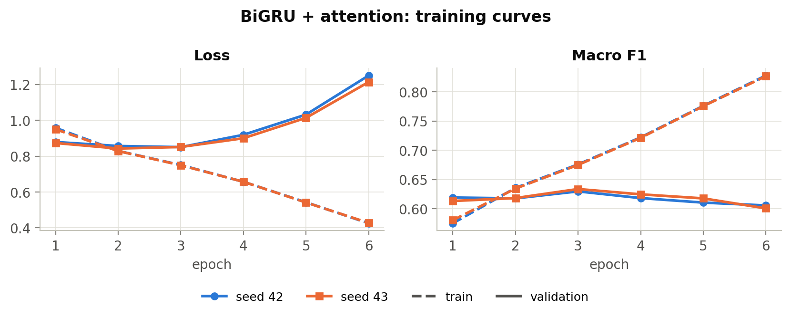
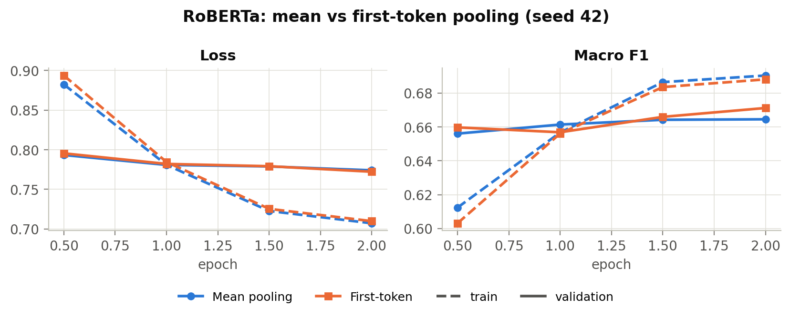
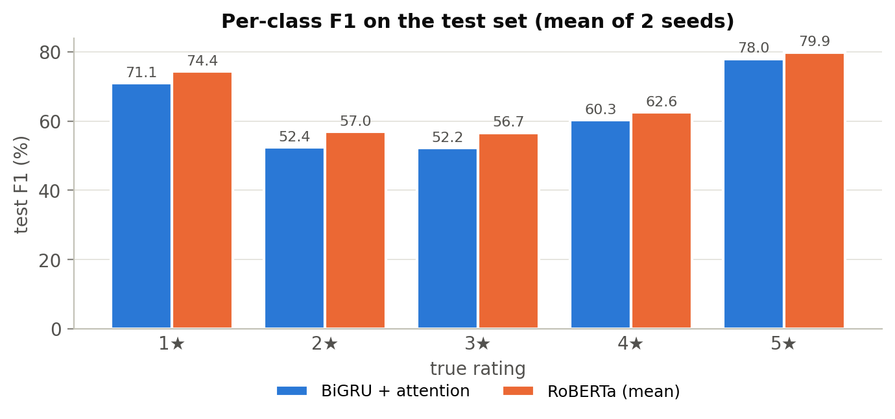
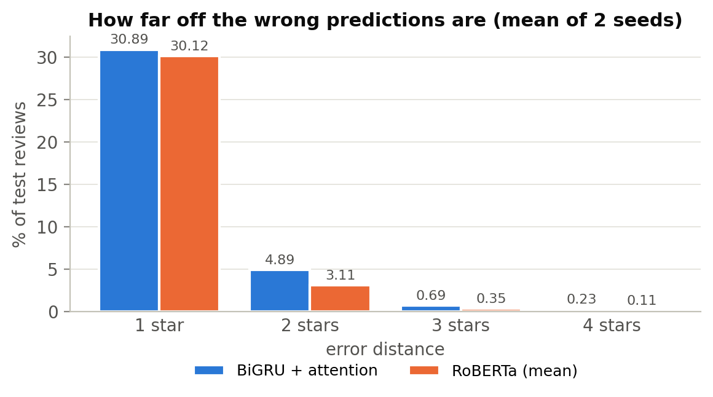
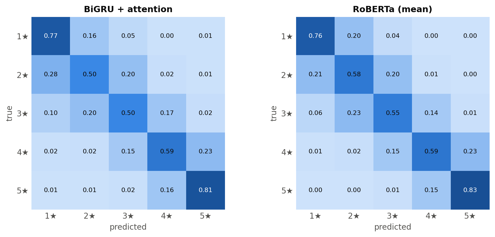
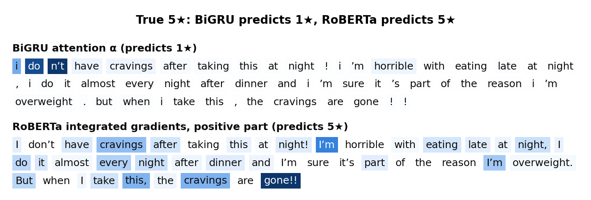

# Question 2: Fine-Tuning RoBERTa for 5-Class Amazon Review Rating Prediction

DSL 504 Natural Language Processing, Group Assignment 2 · Keshav Mishra · October 2026

> The same report as [`report.tex`](report.tex) / [`report.pdf`](report.pdf), in Markdown. Figures are the files the
> notebooks write to [`../outputs/figures/`](../outputs/figures/).

**Summary.** We predict the 1–5 star rating of English Amazon reviews with two models: a BiGRU with additive attention
pooling over GloVe embeddings, and a fully fine-tuned `roberta-base` with masked mean pooling. Over two seeds, RoBERTa
reaches **66.3% accuracy, 66.1% macro-F1 and 0.378 MAE** on the test set against 63.3%, 62.8% and 0.437 for the
BiGRU. RoBERTa improves every class, most of all the ambiguous 2★ and 3★, and halves the number of 1↔5-star
confusions. Its gain over the baseline comes mainly from fewer errors of two or more stars, while confusions between
adjacent ratings such as 4★ vs 5★ barely change. In the ablation, first-token pooling matches mean pooling (66.4% vs
66.1% test macro-F1, within about one seed standard deviation).

## 1. Task, data and protocol

The data is `SetFit/amazon_reviews_multi_en`: 200,000 training, 5,000 validation and 5,000 test reviews, perfectly
balanced (40,000 training and 1,000 validation/test reviews per star). Labels 0–4 are stars − 1, so MAE is in stars.

**Titles.** The SetFit copy keeps only the review body. `mteb/amazon_reviews_multi` (config `en`) holds the same
reviews with the same ids and splits, stored as *title*`\n\n`*body*. Splits and labels are taken from SetFit as the
brief asks; each title is matched by review id and attached only if the two bodies agree after whitespace
normalisation, which held for 100% of reviews in all three splits. The model input is `"<title>. <body>"` (a full stop
is added when the title has no end punctuation).

**Protocol.** Validation is used for early stopping, checkpoint selection and the ablation. The test split is loaded
in exactly one place (`04_evaluation.ipynb`): every run predicts it once, the predictions are saved, and all test
numbers, figures and examples in this report are computed from those saved predictions. Nothing was retrained or
tuned after the test predictions existed.

## 2. Preprocessing: two pipelines

| | Classic (BiGRU) | RoBERTa |
|---|---|---|
| Cleaning | strip HTML tags and URLs, Unicode NFC, lowercase (GloVe 6B is uncased) | none (the tokenizer is cased and byte-level) |
| Tokens | spaCy rule-based English tokenizer (`spacy.blank("en")`) | `RobertaTokenizerFast`, byte-level BPE, `<s> … </s>` |
| Vocabulary | from the training split only, min. frequency 2: 32,878 types incl. `<pad>`=0, `<unk>`=1; test OOV rate 0.39% | fixed 50,265-piece vocabulary; no unknown tokens |
| Embeddings | GloVe 6B 300-d: vectors for 88.1% of types and 99.7% of training tokens; others ~ N(0, σ_GloVe), `<pad>` zero | pre-trained `roberta-base` |
| Length | median 34, 95th pct. 117 tokens; truncated to **200** keeping the head (and so the title); 0.93% of training reviews are longer | median 38, 95th pct. 124; truncated to **256** keeping `</s>`; 0.44% longer |
| Batching | padded per batch with `<pad>`, lengths passed on for packing | `attention_mask`; dynamic padding with `DataCollatorWithPadding` (to a multiple of 8) |

*Table 1. The two input pipelines (statistics on the training split unless stated).*

Both pipelines tokenise once and then pad per batch. Training batches are drawn by a seeded length-grouped sampler
(shuffled pools of similar-length reviews, batch order shuffled), which keeps padding low; evaluation keeps the
split's order so predictions line up with review ids.

## 3. Models

**BiGRU + additive attention (baseline, 12.0 M parameters, 9.9 M of them in the embedding).** 300-d embedding
initialised from GloVe → 2-layer bidirectional GRU, 256 units per direction, dropout 0.3 between layers, on packed
sequences so neither direction reads padding → additive (Bahdanau-style) attention pooling → dropout 0.3 → linear
512→5. With GRU states $h_t$ and mask $m_t$ (1 for real tokens):

$$e_t = v^\top \tanh(W h_t + b), \qquad \alpha_t = \frac{m_t \exp e_t}{\sum_s m_s \exp e_s}, \qquad c = \sum_t \alpha_t h_t$$

The embedding is frozen in epoch 1 and fine-tuned from epoch 2.

**RoBERTa (124.1 M parameters, all trainable).** `RobertaModel` (`roberta-base`) → masked mean of the last hidden
layer over every non-padding token (`<s>` and `</s>` included; the sum is taken in fp32) → dropout 0.1 → linear 768→5:
$p = \sum_t m_t H_t / \sum_t m_t$. The ablation variant uses $p = H_{\langle s\rangle}$ instead.

## 4. Training

| | BiGRU | RoBERTa |
|---|---|---|
| Loss, precision | cross-entropy; fp16 autocast with gradient scaling | cross-entropy; fp16 autocast with gradient scaling |
| Optimiser | Adam, lr 1e-3, gradient clipping at 1.0 | AdamW, lr 2e-5, weight decay 0.01 (none on biases and LayerNorm), clipping at 1.0 |
| Schedule | constant | linear warmup over 6% of steps (750 of 12,500), then linear decay to 0 |
| Batch | 128 | 32, split over two T4 GPUs (`DataParallel`); gradient accumulation supported but not needed |
| Selection | validation after every epoch; early stopping on validation macro-F1, patience 3, at most 15 epochs; best epoch restored | 2 epochs, validation every half epoch; checkpoint with the best validation macro-F1 kept |
| Outcome | best epoch 3 for both seeds, stopped after epoch 6; 3.5 min per run on one T4 | best checkpoint at epoch 2.0 for all four runs; 43 min per run on two T4s |

*Table 2. Training setup. Seeds 42 and 43 for every configuration; the seed is set before building the model and the
data loaders, and the batch sampler and loader workers are seeded too.*

**A library version matters.** With `transformers` 5.16.1 (Kaggle's preinstalled version) the same 20k-review RoBERTa
check run reached only 0.49 validation macro-F1, against 0.64 with 5.20.2; switching the attention implementation,
fp16 vs fp32, and one vs two GPUs made no difference. All reported runs use 5.21.0, and the code refuses to train on
anything older than 5.20.2.

| BiGRU, both seeds, per epoch | RoBERTa, mean vs first-token pooling (seed 42), every half epoch |
|---|---|
|  |  |

*Figure 1. Training (dashed) and validation (solid) loss and macro-F1. RoBERTa's train values average the batches since
the previous evaluation.*

**Curves.** The BiGRU's validation macro-F1 peaks at epoch 3 and its validation loss rises from epoch 4 while training
F1 climbs to 0.83: once the 9.9 M embedding parameters are unfrozen the model memorises the training set quickly, so
early stopping is essential. RoBERTa's validation loss is still falling slowly at epoch 2 with a much smaller
train–validation gap, and every run's best checkpoint is its last one, so a third epoch might add a little (see
Limitations).

## 5. Results

| Model | Val accuracy (%) | Val macro-F1 (%) | Val MAE (stars) | Test accuracy (%) | Test macro-F1 (%) | Test MAE (stars) |
|---|---|---|---|---|---|---|
| BiGRU + attention | 63.55 ± 0.27 | 63.19 ± 0.28 | 0.434 ± 0.003 | 63.30 ± 0.20 | 62.82 ± 0.16 | 0.437 ± 0.002 |
| RoBERTa, mean pooling | 66.64 ± 0.08 | 66.41 ± 0.06 | 0.377 ± 0.002 | **66.31 ± 0.01** | **66.11 ± 0.02** | **0.378 ± 0.001** |
| RoBERTa, first token | 67.11 ± 0.33 | 66.91 ± 0.30 | 0.370 ± 0.004 | 66.54 ± 0.17 | 66.36 ± 0.18 | 0.376 ± 0.002 |

*Table 3. Mean ± sample standard deviation over seeds 42 and 43, at each run's best validation checkpoint. RoBERTa with
mean pooling is the model the brief specifies; first-token pooling is the ablation.*

RoBERTa beats the BiGRU by **+3.0 accuracy, +3.3 macro-F1 and −0.059 MAE** on the test set, gaps 10–20 times larger
than the seed-to-seed spread. Test scores sit within 0.6 points of validation for every model, so selecting
checkpoints on validation did not overfit it. Per class (Figure 2, left), RoBERTa is better everywhere, most on 2★
(+4.6 F1) and 3★ (+4.4) and least on 5★ (+1.9) and 4★ (+2.3). The middle ratings are the hardest for both models
(52–57 F1) because these reviews mix praise and criticism and the line between "disappointing" and "average" is fuzzy
even for people.

| Per-class F1 | Error distance |
|---|---|
|  |  |

*Figure 2. Test set, mean of two seeds. Left: per-class F1. Right: share of all test reviews predicted 1, 2, 3 or 4
stars away from the truth.*

## 6. Ablation: mean vs first-token pooling

Only the pooling changes; data, seeds, schedule and every other setting are identical. On validation, first-token
pooling is 0.50 points of macro-F1 ahead (66.91 ± 0.30 vs 66.41 ± 0.06); on test the lead shrinks to 0.25 points
(66.36 ± 0.18 vs 66.11 ± 0.02), roughly one standard deviation of the first-token runs. With two seeds per arm this is
**no meaningful difference**, and the error profiles match as well (89.5% vs 89.4% of errors are adjacent, Table 4).
Our reading: when all 124 M parameters are fine-tuned on 200k examples, the encoder learns to put the review-level
information wherever the head reads it, so the `<s>` vector becomes as good a summary as the average. The one
consistent difference is stability: mean pooling varied 2–12 times less between seeds on every metric, plausibly
because averaging over all tokens smooths out seed-dependent idiosyncrasies of a single position. The brief's choice
of mean pooling is therefore not more accurate here, but it is the more reproducible of the two.

## 7. Ordinal structure: adjacent vs distant errors

*Figure 3. Row-normalised test confusion matrices, counts pooled over both seeds: cell (i, j) is the share of true
i-star reviews predicted as j stars.*

| Model | Off by 1 (% of reviews) | Off by ≥2 (% of reviews) | Adjacent share of errors | 1★↔2★ | 2★↔3★ | 3★↔4★ | 4★↔5★ | 1★↔3★ | 1★↔5★ |
|---|---|---|---|---|---|---|---|---|---|
| BiGRU + attention | 30.89 | 5.81 | 84.2% | 439.0 | 404.0 | 313.5 | 388.0 | 155.5 | 11.5 |
| RoBERTa, mean | 30.12 | 3.57 | 89.4% | 407.0 | 429.0 | 291.5 | 378.5 | 99.5 | 5.5 |
| RoBERTa, first token | 29.93 | 3.53 | 89.5% | 404.0 | 416.0 | 290.0 | 386.5 | 97.0 | 6.5 |

*Table 4. How far off the errors are (mean of two seeds; 5,000 test reviews per run). The pair columns count
confusions between two ratings in both directions, per run.*

Both models treat the ratings as a scale even though plain cross-entropy knows nothing about order: most mass sits on
the diagonal and its neighbours (Figure 3), and 84% (BiGRU) and 89% (RoBERTa) of all errors are only one star off. The
difference between the models lies almost entirely in the *distant* errors. RoBERTa's 3.0-point gain in exact
predictions comes with a 2.2-point drop in errors of two or more stars (5.81% → 3.57%, a 39% relative reduction) but
only a 0.8-point drop in one-star errors; 1★↔3★ swaps fall by a third and 1★↔5★ swaps halve (11.5 → 5.5 per run).
Adjacent boundaries, in contrast, barely move: both models send 23% of true 4★ reviews to 5★, 4★↔5★ confusions drop
only from 388 to 379, and 2★↔3★ confusions even rise slightly. RoBERTa reads the polarity and rough intensity of a
review much better, but where to draw the line between neighbouring ratings is partly a matter of each reviewer's
personal scale, which no text model can fully recover. An ordinal loss (e.g. cumulative-link or expected-cost
training) would target exactly these boundaries.

## 8. Qualitative comparison

On the test set, 242 reviews are classified correctly by both RoBERTa seeds and wrongly by both BiGRU seeds; 158 the
other way round. Requiring both seeds to agree keeps out examples that are one seed's luck. To see which kinds of
review drive the difference we flag four phenomena with simple word patterns (Table 5); the flags are rough and
sarcasm cannot be caught by a pattern, so the examples below were read and labelled by hand.

| Group (pattern) | Reviews | BiGRU acc. (%) | RoBERTa acc. (%) | Gain |
|---|---|---|---|---|
| negation (*not, no, never, n't*, …) | 2,858 | 60.1 | 63.5 | +3.4 |
| mixed / contrast (*but, however, although*, …) | 1,905 | 56.6 | 60.3 | +3.7 |
| long (>120 spaCy tokens, about the 95th pct.) | 216 | 57.2 | 60.0 | +2.8 |
| rare words / typos (≥2 words outside the BiGRU vocabulary) | 158 | 59.8 | 66.1 | +6.3 |
| none of the above | 1,539 | 70.1 | 72.8 | +2.7 |

*Table 5. Test accuracy (mean of two seeds) by flagged group; a review can be in several groups.*

Every flagged group is harder than unflagged reviews for both models, and RoBERTa gains most where its byte-level BPE
helps (rare words and typos, +6.3, though on only 158 reviews) and on contrastive reviews (+3.7).

| | Review (excerpt) | True | BiGRU | RoBERTa | Phenomenon |
|---|---|---|---|---|---|
| | ***RoBERTa right, BiGRU wrong (both seeds)*** | | | | |
| A | "I don't have cravings after taking this at night! I'm horrible with eating late at night, […] But when I take this, the cravings are gone!!" | 5 | 1, 2 | 5, 5 | negation, contrast |
| B | "Fit my 2018 Accord pretty good the back part of the seat isnt fully covered completely but most is, Came a bit wrinkled but not to bad, material is actually good quality" | 4 | 3, 3 | 4, 4 | typos, negated negative |
| C | "better than the original decaf Senseo pods. […] almost indistinguishable from the regular caffeinated coffee. Recommend." | 5 | 4, 4 | 5, 5 | rare word, comparison |
| D | "[…] Whatever that was, it wasn't really present in the sequel. […] well, let's just say it's all a bit rushed and bordering on repeated examples of deus ex machina […]" | 3 | 4, 4 | 3, 3 | irony, mixed, long |
| E | "Works 100% on curling-ironed hair. […] it tends to leave my hair with a cooked kind of smell. This spray works! […] it doesn't dry it out" (128 words) | 5 | 3, 2 | 5, 5 | long, problem–solution |
| F | "The Good: -came with a free gym towel […] The Bad -the only issue […] Overall: 4.5/5" | 4 | 2, 5 | 4, 4 | pros/cons list, explicit score |
| | ***BiGRU right, RoBERTa wrong (both seeds)*** | | | | |
| G | "Not fully described. Amazon did't disclose the return policy of restock fee which is called cheating." | 1 | 1, 1 | 2, 2 | short, negation |
| H | "Probably very good, but my boy won't eat them. I hate to give this product one star when it probably deserves 5. […]" | 1 | 1, 1 | 3, 2 | concession, hedging |
| I | "[…] if you're comfortable with being stuck with a subscription every year at $100 per camera then it is a decent camera but it's useless without the subscription." | 1 | 1, 1 | 2, 2 | concession, long |

*Table 6. Test examples chosen by `pick_examples` (most confident first, covering as many flags as possible);
predictions are listed for seeds 42, 43. Full texts and ids are in
[`test_examples.json`](../outputs/results/test_examples.json).*

**Where RoBERTa wins.** The common thread is *composition*: the rating depends on how words combine, not on which words
occur. In A and B the negative words are negated or resolved ("don't have cravings", "not to bad", "isn't fully
covered … but most is"); the BiGRU sees "don't" and "horrible" and predicts 1★–3★. C hinges on a product name that is
`<unk>` for the BiGRU ("Senseo") and on a comparison ("better than"); E describes a problem at length ("cooked kind of
smell") before the product solves it. D is the sarcasm-like case: the ironic "well, let's just say … deus ex machina"
wraps praise for the characters, and RoBERTa settles on the middle rating while the BiGRU follows the positive words.
In F the reviewer even states "4.5/5" inside a pros-and-cons list; the two BiGRU seeds disagree wildly (2★ and 5★),
RoBERTa reads it correctly.

**Where the BiGRU wins.** All three are 1★ reviews that RoBERTa rates higher (by one star in five of the six
predictions), and each contains a concession: "probably very good", "probably deserves 5", "a decent camera", or in G a
complaint about policy rather than the product. RoBERTa weighs these hedges, while the reviewer's verdict is harsh; the
BiGRU keys on strongly negative words ("cheating", "useless", "won't eat") and lands on 1★. Its wins are thus mostly
adjacent-rating decisions where a cruder reading happens to match how the reviewer mapped sentiment to stars.

*Figure 4. Example A, every word shaded by its weight (darkest = largest in that row). Top: BiGRU attention weights
α_t over its lowercased spaCy tokens. Bottom: RoBERTa token importance by integrated gradients for the predicted 5★
logit, sub-word pieces summed into words; only the positive part (evidence for 5★) is shaded. The weights are in
[`test_token_importance.json`](../outputs/results/test_token_importance.json).*

**What the models look at.** For RoBERTa we use integrated gradients (Sundararajan et al., 2017) on the input
embeddings: 256 steps from a baseline in which every token except `<s>` and `</s>` is replaced by `<pad>`. The
attributions add up to the change in the logit (here 4.24, with a completeness error of 0.04). In Figure 4, the
strongest evidence *for* 5★ is "gone!!" at the very end (+1.09) and the first-person "I'm" (+0.65); "don't" (−0.62)
and "horrible" (−0.41) are the strongest evidence *against*. RoBERTa therefore registers the negative words as
negative, but the resolution at the end outweighs them. The BiGRU's attention, by contrast, piles onto "do" and "n't"
in the first sentence and it predicts 1★: the negation cue is found, but the pooled vector carries "negative" rather
than "negated negative". A second example ([`test_token_highlights_1.png`](../outputs/figures/test_token_highlights_1.png),
example C) shows both models focusing on "Recommend" (IG +1.90), yet only RoBERTa reaches 5★; the BiGRU also has to
read "Senseo" as `<unk>`. Two caveats apply: attention weights show what was pooled, not what changed the decision,
and integrated gradients depend on the chosen baseline.

## 9. Conclusions and limitations

- Fine-tuned RoBERTa is clearly better than a well-tuned BiGRU + attention baseline: +3.3 macro-F1 and −0.059 MAE on
  test, ahead in every class, with the largest gains on the ambiguous middle ratings.
- The gain is mostly about *severity*: RoBERTa removes 39% of the errors of two or more stars and half of the 1↔5
  swaps, but adjacent-rating confusions (especially 4★ vs 5★) stay at the baseline's level.
- Qualitatively, RoBERTa handles negated negatives, contrast, rare words and typos better; its own errors are
  concessive 1★ reviews that it rates too high, usually by one star.
- Mean and first-token pooling perform the same within seed noise; mean pooling is the more stable choice.

**Limitations.** (i) Two seeds give only a rough estimate of variance, so small differences such as the pooling
ablation cannot be resolved. (ii) Every RoBERTa run peaked at its final checkpoint; a third epoch might help, but
retraining after the test predictions existed would have meant evaluating the test set twice, so we report the runs as
they are. (iii) Confusion matrices pool both seeds, and the phenomenon flags are word patterns, not annotations.
(iv) The BiGRU overfits quickly after its embeddings are unfrozen; a smaller learning rate for the embedding might give
it a fairer chance. (v) Truncation affects under 1% of reviews and is not a factor here.

**Reproducibility.** Code: `Question-2/` (notebooks `01`–`04` and package `q2/`); each run writes its configuration,
seed, library versions and git commit to `run_info.json`. Training ran on Kaggle (one T4 for the BiGRU, two T4s for
RoBERTa) with PyTorch 2.11 and `transformers` 5.21.0.
