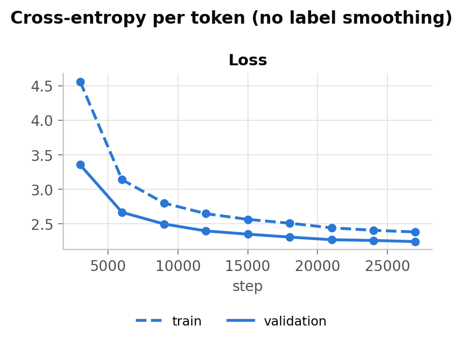
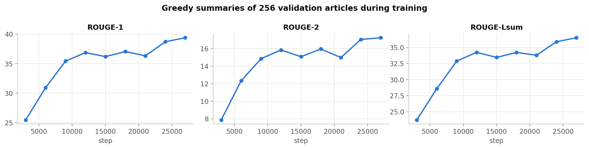
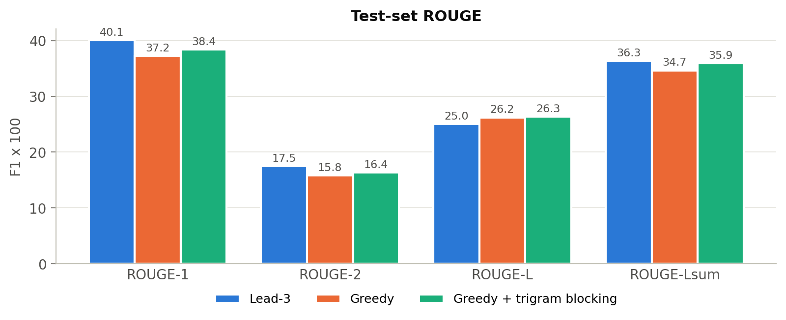
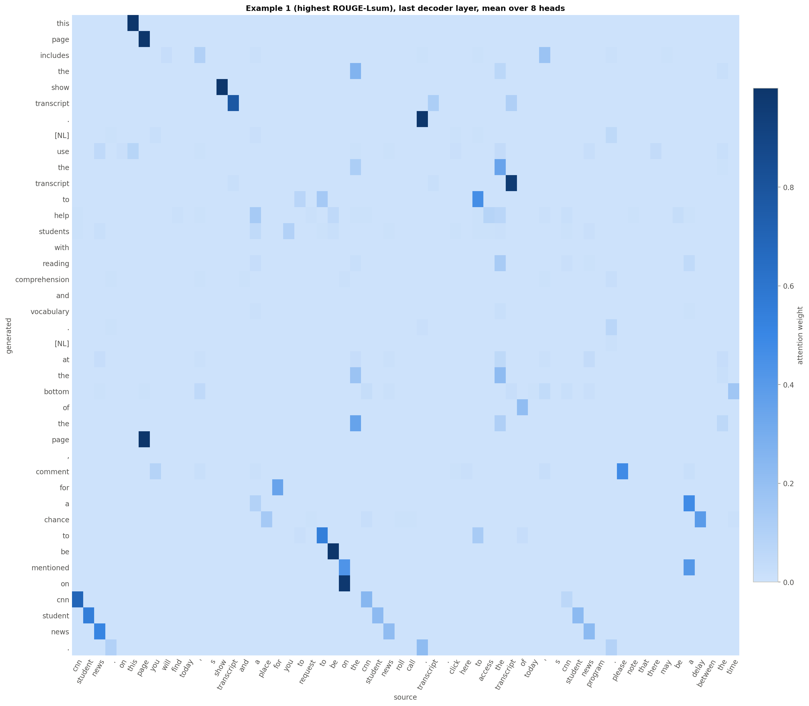
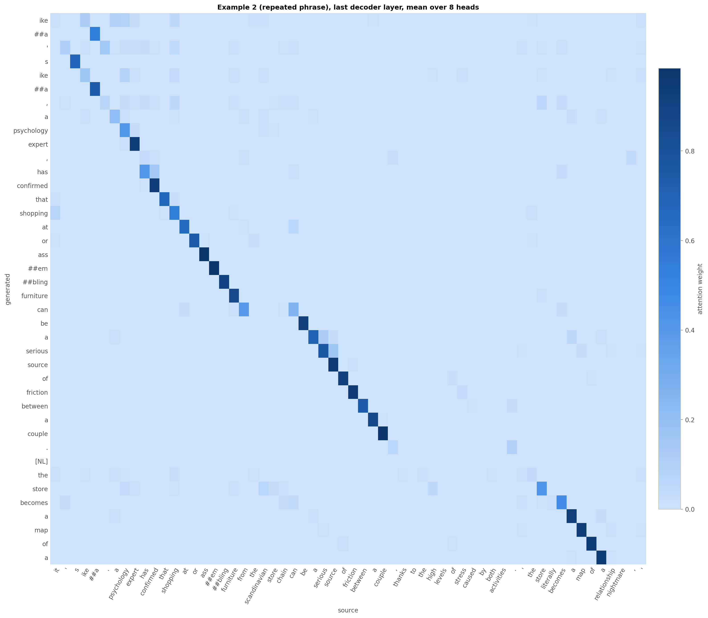
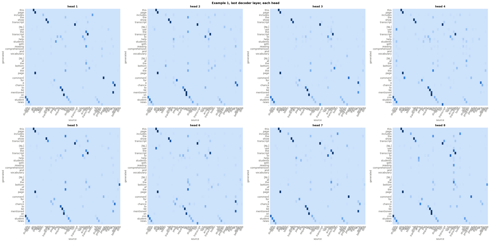
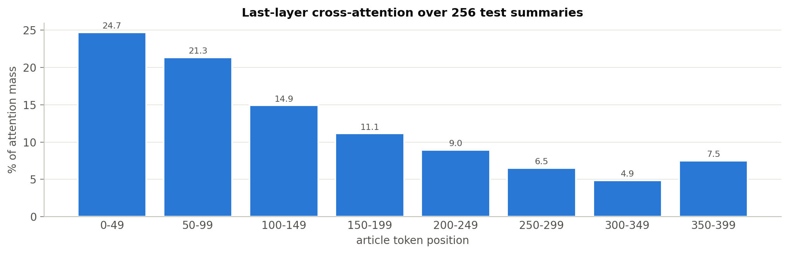

# Question 3: Abstractive summarisation with a Transformer written from scratch

## Summary of the setup

| Item | Value |
|---|---|
| Dataset | CNN / Daily Mail abisee/cnn_dailymail 3.0.0 (Hugging Face) |
| Training-set size | 287,113 article-summary pairs (1,728,000 pairs seen = 6.02 epochs) |
| Validation / test | 13,368 / 11,490 pairs |
| Tokenizer | `bert-base-uncased` WordPiece (uncased; only the tokenizer is pre-trained) + `[NL]` sentence-break token; one shared vocabulary of 30,523 |
| Truncation | article 400 tokens, summary 128 tokens (both incl. start/end) |
| Model | encoder-decoder, d_model 512, 8 heads, 4 encoder + 4 decoder layers, d_ff 2048, dropout 0.1, copy mechanism on |
| Parameters | 45,054,465 (all trained from random initialisation) |
| Decoding | greedy, up to 128 tokens; also greedy + trigram blocking (main result: **Greedy + trigram blocking**, chosen on validation) |
| Test ROUGE F1, Greedy + trigram blocking | ROUGE-1 38.42 / ROUGE-2 16.38 / ROUGE-L 26.32 / ROUGE-Lsum 35.93 |

## 1. Data and preprocessing

We use CNN/DailyMail version 3.0.0 with the official splits: 287,113 training, 13,368 validation and 11,490 test pairs. The model learns only from the training split; the validation split is used for early stopping and for choosing the decoding setting; the test split is used once, for the final ROUGE scores.

Preprocessing, in order:

1. **Lowercasing** of articles and highlights, matching the uncased tokenizer.
2. **Sentence breaks.** The newline between highlight sentences becomes the special token `[NL]`, so the model learns where sentences end and its output can be written one sentence per line, as ROUGE-Lsum requires. The references used for scoring keep their original newlines.
3. **Sub-word tokenisation** with the pre-trained `bert-base-uncased` WordPiece tokenizer. Articles and summaries share one vocabulary (30,523 entries). `[CLS]` is the start token and `[SEP]` the end token of every sequence; `[PAD]` (id 0) is padding.
4. **Truncation.** Articles keep their first 400 tokens and summaries their first 128; a truncated sequence still ends with `[SEP]`. News articles put the key facts first, so little is lost.
5. **Padding** of each batch to its longest sequence. Decoder input = summary shifted right (starts with `[CLS]`); target = summary shifted left (ends with `[SEP]`).

Token lengths (including `[CLS]`/`[SEP]`) before truncation:

| Split | Text | Median | 90th pct | Max | Limit | Truncated |
|---|---|---|---|---|---|---|
| train | article | 800 | 1481 | 6323 | 400 | 89.9% |
| train | summary | 63 | 99 | 2302 | 128 | 2.8% |
| validation | article | 765 | 1476 | 2417 | 400 | 87.1% |
| validation | summary | 69 | 111 | 1897 | 128 | 4.5% |
| test | article | 780 | 1504 | 2967 | 400 | 87.8% |
| test | summary | 66 | 104 | 859 | 128 | 3.5% |

## 2. Model: a Transformer written from scratch

All components are written with basic tensor operations and `nn.Linear`, `nn.Embedding`, `nn.LayerNorm` and `nn.Dropout` (file `q3_model.py`). No `nn.Transformer*`, `nn.MultiheadAttention`, `F.scaled_dot_product_attention`, Hugging Face model class or pre-trained weight is used; a check in the notebook scans the code and the model for them.

- **Positional encoding**: fixed sinusoids, PE(pos, 2i) = sin(pos / 10000^(2i/d_model)), PE(pos, 2i+1) = cos(pos / 10000^(2i/d_model)), added to the token embeddings (scaled by sqrt(d_model)).
- **Multi-head attention**: Attention(Q, K, V) = softmax(QK^T / sqrt(d_k) + mask) V with 8 heads of size 64, separate Q, K, V and output projections.
- **Position-wise feed-forward**: FFN(x) = max(0, xW1 + b1)W2 + b2 with inner size 2048.
- **Encoder layer**: self-attention, then feed-forward. **Decoder layer**: masked self-attention, encoder-decoder (cross) attention, then feed-forward. Every sub-layer is wrapped as LayerNorm(x + Dropout(Sublayer(x))).
- **Masks** (True = may attend): a source padding mask in encoder self-attention and in cross-attention; a causal (look-ahead) mask combined with a target padding mask in decoder self-attention.
- **Output**: a final linear layer maps decoder states to vocabulary logits. As in the paper, its weight is shared with the embedding (one matrix for encoder input, decoder input and output).
- **Copy (pointer) switch** on top of the Transformer, following See et al. (2017). At every summary position a gate p_gen = sigmoid(W [decoder state; article context] + b) mixes two distributions: P(w) = p_gen * P_vocab(w) + (1 - p_gen) * (attention on the article positions that hold w). The copy distribution is the last decoder layer's cross-attention averaged over heads, and the context is that attention applied to the encoder output. The gate adds 1,025 parameters. Without it the decoder must produce every name and number from the vocabulary softmax, and in early training it writes fluent but unrelated text; with it, words can be taken straight from the article. The loss is -log P(target) of the mixed distribution, computed for the target word only.

| Setting | Value |
|---|---|
| d_model / heads / d_ff | 512 / 8 / 2048 |
| Encoder / decoder layers | 4 / 4 |
| Dropout | 0.1 |
| Vocabulary | 30,523 (shared) |
| Parameters | 45,054,465 total, 45,054,465 trainable |

## 3. Training

- **Loss**: token-level cross-entropy with label smoothing 0.1; padding positions are excluded from the loss and from the token count. The validation loss, the loss curves and early stopping use plain (unsmoothed) cross-entropy, so train and validation numbers are comparable.
- **Teacher forcing**: the gold summary shifted right is the decoder input, so the whole summary is trained in one parallel pass; the causal mask stops each position from seeing later tokens.
- **Optimiser**: Adam, betas (0.9, 0.98), eps 1e-9, with the paper's schedule lr = d_model^-0.5 * min(step^-0.5, step * warmup^-1.5), warmup 4,000 steps (peak lr 6.99e-04). Gradients clipped to norm 1.0. Precision: fp16 autocast with loss scaling.
- **Batches**: 64 pairs per step on 2 x Tesla T4.
- **Early stopping**: validation loss on all 13,368 validation pairs every 3,000 steps, patience 3 checks, time budget 3.25 h. The best checkpoint is restored before any test evaluation.
- **Run**: 27,000 steps, 1,728,000 pairs seen (6.02 epochs) in 3.25 h. Training stopped because of: **time budget of 3.25 h reached**. Best validation loss 2.244 (perplexity 9.4) at step 27,000; that checkpoint is the one evaluated.

The second plot decodes the same 256 validation articles greedily at every check. Validation ROUGE-1 / 2 / Lsum went from 25.5 / 7.9 / 23.7 at the first check (step 3,000) to 39.4 / 17.3 / 36.5 at the best checkpoint. Watching free-running summaries, not only the loss, is what catches a broken causal mask (falling loss, useless summaries).

To check that the summaries depend on the article, the same 256 reference summaries were also scored against a different article (each batch rotated by one). At the first check the loss was 3.27 with the right article vs 6.55 with a wrong one; at the best checkpoint 2.16 vs 5.29 (gap 3.14 nats per token). The model's predictions are strongly tied to the article it is given, not generic summary text.
The average copy gate on validation summaries is p_gen = 0.22: the model puts about 78% of the weight on copying from the article and 22% on generating from the vocabulary.
The best validation loss was at the last check, so the model was still improving when the time budget ended; a longer run would very likely score higher.

**Checks run before training** (all must pass, otherwise the notebook stops):

| Check | Result |
|---|---|
| no_banned_layers | pass |
| causal_mask | pass |
| source_padding_mask | pass |
| target_padding_mask | pass |
| loss_ignores_padding | pass |
| memorise_8_real_pairs | pass |

## 4. Decoding

Generation uses no teacher forcing. Each article is encoded once; the decoder starts from `[CLS]`, and at every step the most likely token (greedy) is appended and fed back in, until `[SEP]` or 128 tokens. `[PAD]`, `[CLS]` and `[UNK]` are never generated. Token ids are converted back to text and split into lines at `[NL]` before scoring.

We also tried greedy decoding with **trigram blocking**: a token is not allowed if it would repeat a trigram already in the summary (Paulus et al., 2018), a common fix for the repetition greedy decoding causes. The choice between the two was made on 1,000 validation articles, never on the test set:

| Decoding (validation) | ROUGE-1 | ROUGE-2 | ROUGE-L | ROUGE-Lsum |
|---|---|---|---|---|
| Greedy | 38.83 | 17.09 | 27.39 | 36.30 |
| Greedy + trigram blocking | 40.25 | 17.91 | 27.74 | 37.81 |

Main result: **Greedy + trigram blocking**. Plain greedy, which the brief requires, is reported as well.

## 5. Results on the test set

F1 scores (x100) on all 11,490 test pairs with `rouge_score` (use_stemmer=True); 95% bootstrap confidence intervals in brackets. **ROUGE-L** treats each summary as one sequence; **ROUGE-Lsum** splits both summaries into sentences at newlines and is the usual CNN/DM metric.

| System | ROUGE-1 | ROUGE-2 | ROUGE-L | ROUGE-Lsum |
|---|---|---|---|---|
| Lead-3 (brief) | 40.06 | 17.48 | 25.02 | 36.36 |
| Lead-3 (our run) | 40.05 [39.82, 40.28] | 17.48 [17.27, 17.70] | 25.02 [24.82, 25.22] | 36.35 [36.13, 36.57] |
| Greedy | 37.21 [36.98, 37.43] | 15.83 [15.62, 16.05] | 26.22 [26.02, 26.41] | 34.65 [34.43, 34.87] |
| Greedy + trigram blocking | 38.42 [38.20, 38.63] | 16.38 [16.16, 16.60] | 26.32 [26.13, 26.53] | 35.93 [35.71, 36.13] |

Our own Lead-3 run gives 40.05, 17.48, 25.02, 36.35 against the brief's 40.06, 17.48, 25.02, 36.36 (sentence splitter: nltk); identical, which confirms the scoring pipeline is the standard one.

### Comparison with Lead-3

Relative to Lead-3, Greedy + trigram blocking scores -1.63 ROUGE-1, -1.10 ROUGE-2, +1.30 ROUGE-L and -0.42 ROUGE-Lsum points, so it is below Lead-3 on ROUGE-1, ROUGE-2, ROUGE-Lsum. The brief expects a from-scratch model with limited compute to score below Lead-3. What separates the two systems:

- **Lead bias of news.** Journalists put the key facts in the first sentences and the highlights paraphrase them. Lead-3 copies those sentences word for word, so it gets facts, names and numbers exactly right at no cost. Our model has to learn language, content selection and generation from random weights.
- **Small compute.** 6.02 epochs in 3.3 h on 2 x Tesla T4, with 45M parameters and no pre-training. Published Transformer baselines train for days on several GPUs, and pre-trained models (BART, PEGASUS) add large-scale pre-training on top.
- **Copying is learned, not exact.** The copy switch lets the model take names and numbers from the article, but it still has to learn which ones belong in the summary and when to copy rather than generate; mistakes show up as wrong or swapped entities (see the checks below).
- **Greedy decoding** commits to one token at a time; beam search usually adds some ROUGE.
- **Truncation** to 400 tokens cuts 88% of test articles, so highlights drawn from later in the article cannot be found. Lead-3 only reads the start and is not affected.
- **ROUGE measures word overlap.** A correct paraphrase scores lower than a copied sentence, and an abstractive model paraphrases (see the novel-bigram rate below).

ROUGE-L and ROUGE-Lsum are different metrics (Greedy + trigram blocking: ROUGE-L 26.32, ROUGE-Lsum 35.93; ROUGE-L is lower for every system). Plain ROUGE-L needs one common subsequence across the whole summary, so content in a different sentence order is lost; ROUGE-Lsum matches each reference sentence against the generated sentences separately, which is why it needs the newlines.

### What the generated summaries look like

| Measured on the test set | Reference | Lead-3 | Greedy | Greedy + trigram blocking |
|---|---|---|---|---|
| Average length (words) | 52.9 | 78.8 | 56.0 | 55.4 |
| Average sentences | 3.88 | 3.00 | 3.54 | 3.59 |
| Summaries with a repeated word trigram | 7.2% | 21.8% | 57.3% | 7.9% |
| Summaries with a number not in the article | 9.8% | 0.0% | 0.6% | 1.2% |
| Bigrams not in the article (abstractiveness) | 50.0% | 0.0% | 9.8% | 13.3% |
| Empty summaries | 0.00% | 0.00% | 0.00% | 0.00% |

Plain greedy decoding repeats a word trigram in 57.3% of summaries (references: 7.2%). Trigram blocking brings this to 7.9% (blocking works on sub-word tokens and allows trigrams around a sentence break, so word-level repeats can remain) and changes test ROUGE-Lsum by +1.28 points. 0.6% of greedy summaries contain a number that never occurs in the article, against 9.8% of the human references (which sometimes compute or reword numbers). The check is rough, it only compares digit strings, but it points at the main factual weakness: numbers and names are generated, not copied.

## 6. Qualitative examples

Test articles chosen automatically to cover good and bad cases (best, median and worst greedy ROUGE-Lsum, a repeated phrase, a number not in the article, one random). Articles are cut to their first 120 words; scores are ROUGE-1 / ROUGE-2 / ROUGE-Lsum.

### Example 1: highest ROUGE-Lsum (test id `23d1195f78742c6abe27bb5447ac993a78fcedd1`)

**Article (start):**

> April 3, 2015 . We're starting with some international headlines today, covering events in Switzerland, Kenya and the Pacific Ocean. California's historic drought is now hitting home for many residents and businesses, who've been ordered to cut their water usage. We discuss two religious holidays being celebrated worldwide this weekend, and we take a look at a pair of subjects related to U.S. National Parks. It's all featured this Friday on CNN Student News. On this page you will find today's show Transcript and a place for you to request to be on the CNN Student News Roll Call. TRANSCRIPT . Click here to access the transcript of today's CNN Student News program. Please note that there may be a ...

**Reference:**

> This page includes the show Transcript .
> Use the Transcript to help students with reading comprehension and vocabulary .
> At the bottom of the page, comment for a chance to be mentioned on CNN Student News.  You must be a teacher or a student age 13 or older to request a mention on the CNN Student News Roll Call.
> The Weekly Newsquiz tests students' knowledge of events in the news .

**Greedy** (100.0 / 100.0 / 100.0):

> this page includes the show transcript.
> use the transcript to help students with reading comprehension and vocabulary.
> at the bottom of the page, comment for a chance to be mentioned on cnn student news. you must be a teacher or a student age 13 or older to request a mention on the cnn student news roll call.
> the weekly newsquiz tests students'knowledge of events in the news.

**Greedy + trigram blocking** (97.1 / 95.5 / 97.1):

> this page includes the show transcript.
> use the transcript to help students with reading comprehension and vocabulary.
> at the bottom of the page, comment for a chance to be mentioned on cnn student news. you must be a teacher or a student age 13 or older to request a mention on the cnn student cnn student call.
> the weekly newsquiz tests students'knowledge of events in the news.

**Automatic notes:** Greedy ROUGE-Lsum 100.0 (test median 34.1); 68 words vs 68 in the reference. Greedy output repeats "cnn student news". Trigram blocking removes the repetition.

### Example 2: median ROUGE-Lsum (test id `fce8dbac35879e535fea657ba95556b3dc576e9e`)

**Article (start):**

> Robert Downey Jr has been accused of making a racist remark about an Oscar-winning Mexican director during an interview. The actor, who is promoting his new film Avengers: Age of Ultron, was asked what he thought of Alejandro Gonzalez Inarritu's claim that superhero movies were 'cultural genocide'. The Hollywood star told The Guardian: 'Look I respect the heck out of him. I think for a man whose native tongue is Spanish to be able to put together a phrase like 'cultural genocide' just speaks to how bright he is.' The controversial comments sparked a furious backlash on Twitter, with some calling it 'racist' and 'ignorant'. It comes just three days after the 50-year-old, who plays Iron Man in the film, ...

**Reference:**

> Avengers star made remarks about Alejandro Gonzalez Inarritu .
> The 51-year-old won best director for Birdman at this year's Oscars .
> Said in an interview last year superhero films represent 'cultural genocide'
> Downey Jr said for a Spanish-speaking man to use a phrase like that 'speaks to how bright he is'
> Comments come just days after he walked out of a TV interview in Britain .

**Greedy** (39.0 / 9.9 / 34.1):

> robert downey jr has been accused of making a racist remark.
> he is promoting his new film avengers : age of ultron.
> the hollywood star is promoting his new film avengers : age of ultron.
> he said :'i think for a man whose native tongue is spanish to be able to put together a phrase like'cultural genocide '

**Greedy + trigram blocking** (39.0 / 9.9 / 34.1):

> robert downey jr has been accused of making a racist remark.
> he is promoting his new film avengers : age of ultron.
> the hollywood star is promoting the film avengers and is promoting avengers.
> he said :'i think for a man whose native tongue is spanish to be able to put together a phrase like'cultural genocide '

**Automatic notes:** Greedy ROUGE-Lsum 34.1 (test median 34.1); 56 words vs 67 in the reference. Greedy output repeats "is promoting his" and more. Trigram blocking removes the repetition.

### Example 3: repeated phrase (test id `d0ee59002d2772aea6d1fef63ef2153f11cff02f`)

**Article (start):**

> Many people might think that trust issues, long distances and cheating scandals are the biggest strains on a relationship. But they are wrong. It's IKEA. A psychology expert has confirmed that shopping at or assembling furniture from the Scandinavian store chain can be a serious source of friction between a couple, thanks to the high levels of stress caused by both activities. 'The store literally becomes a map of a relationship nightmare,' Ramani Durvasula, a clinical psychologist in Santa Monica, California, told The Wall Street Journal. Scroll down for video . Can your relationship handle it? Experts say that shopping at IKEA can cause serious friction between couples - and assembling the store's wares makes it even worse . 'Walking ...

**Reference:**

> A psychology expert has revealed that the stress of a visit to the store can cause serious friction between couples .
> She warned that customers avoid one particular unit known as the Liatorp, which retails for $1,199 and is notoriously tricky to build .

**Greedy** (35.1 / 21.1 / 33.0):

> ikea's ikea, a psychology expert, has confirmed that shopping at or assembling furniture can be a serious source of friction between a couple.
> the store becomes a map of a relationship nightmare, but experts say that shopping at ikea can cause serious friction between couples.
> the store's wares makes it even worse.

**Greedy + trigram blocking** (35.3 / 20.0 / 33.3):

> ikea's ikea, a psychology expert, has confirmed that shopping at or assembling furniture can be a serious source of friction between a couple.
> the store becomes a map of a relationship nightmare, but experts say that shopping can cause serious friction between couples.
> walking through the kitchens brings up touchy subjects, like who does most of the cooking.

**Automatic notes:** Greedy ROUGE-Lsum 33.0 (test median 34.1); 54 words vs 43 in the reference. Greedy output repeats "that shopping at". Trigram blocking removes the repetition.

### Example 4: number not in the article (test id `5871b2ec5d6d79e202b9e5750b27991004dfc37f`)

**Article (start):**

> It was one of Barcelona's easier nights in the Champions League as Luis Enrique's team brushed aside Paris Saint-Germain 2-0 at the Nou Camp to reach the semi-finals. The 5-1 aggregate victory never looked in doubt as the Spanish side showed signs of returning to their brilliant best, with a combination of experienced stars and blossoming talent in their ranks. Here Sportsmail looks at the five things we have learned from Barca's crushing victory over PSG. Neymar (left) celebrates opening the scoring for Barcelona along with Dani Alves (centre) and Gerard Pique . Neymar is a blend of Cristiano Ronaldo and Lionel Messi . He’s just a child, said Juliano Belletti in the week. Some child. Let’s not go overboard; ...

**Reference:**

> Barcelona cruised into UEFA Champions League semi-finals .
> Neymar and Andres Iniesta star men for Barca in 2-0 win over PSG .
> Paris Saint-Germain lost 5-1 on aggregate and must make smart transfers .
> Neymar has blend of Cristiano Ronaldo and Lionel Messi .

**Greedy** (30.0 / 12.8 / 30.0):

> barcelona defeated paris saint - germain 2 - 0 in the champions league.
> neymar has scored twice in the last 16 of the champions league.
> luis enrique's side have now won just once in the last 16.

**Greedy + trigram blocking** (30.4 / 13.0 / 30.4):

> barcelona defeated paris saint - germain 2 - 0 in the champions league.
> neymar has scored twice in the last 16 of the champions.
> luis enrique's side have now won four of their last four games.

**Automatic notes:** Greedy ROUGE-Lsum 30.0 (test median 34.1); 36 words vs 44 in the reference. Greedy output repeats "the champions league" and more. Trigram blocking removes the repetition. Numbers not in the article: 16.

### Example 5: lowest ROUGE-Lsum (test id `130663882dcf622a6069d2ab429acde689b9f428`)

**Article (start):**

> (CNN)"Star Wars" is once again back in our lives, the Burger-King couple helped us believe love can be found in fast food, and Mindy Kaling's brother had a shocking announcement. Those are just a few of the stories that trended this week. 1. 'Star Wars' streaming . The Force is with the streaming device of your choice, thanks to this week's surprise announcement that the entire "Star Wars" saga (so far, anyway) would be released on digital HD at the end of the week. Between this and the release of "Daredevil," we imagine lots of nerds called in sick on Friday. 2. Mindy Kaling's brother: I faked being black to get into medical school . Actress Mindy Kaling's brother says ...

**Reference:**

> A couple named Burger and King?
> Internet has a meltdown over "Vampire Diaries" departure .

**Greedy** (0.0 / 0.0 / 0.0):

> " star wars " is once again back in our lives, says mindy kaling's brother.
> the force is with the streaming device of your choice.
> the experience opened his eyes to what he calls the hypocrisy of affirmative action.

**Greedy + trigram blocking** (0.0 / 0.0 / 0.0):

> " star wars " is once again back in our lives, says mindy kaling's brother.
> the force is with the streaming device of your choice.
> the experience opened his eyes to what he calls the hypocrisy of affirmative action.

**Automatic notes:** Greedy ROUGE-Lsum 0.0 (test median 34.1); 38 words vs 14 in the reference. No repeated phrase and no number missing from the article; names and facts still have to be checked against the article by reading it.

### Example 6: random example (test id `12078b09d95c01cedb06da7fc63faab540432dee`)

**Article (start):**

> (CNN) I see signs of a revolution everywhere. I see it in the op-ed pages of the newspapers, and on the state ballots in nearly half the country. I see it in politicians who once preferred to play it safe with this explosive issue but are now willing to stake their political futures on it. I see the revolution in the eyes of sterling scientists, previously reluctant to dip a toe into this heavily stigmatized world, who are diving in head first. I see it in the new surgeon general who cites data showing just how helpful it can be. I see a revolution in the attitudes of everyday Americans. For the first time a majority, 53%, favor its legalization, ...

**Reference:**

> CNN's Dr. Sanjay Gupta says we should legalize medical marijuana now .
> He says he knows how easy it is do nothing "because I did nothing for too long"

**Greedy** (9.1 / 0.0 / 6.1):

> lz granderson : i see signs of a revolution everywhere. i see it in the eyes of sterling scientists.
> granderson : i see it in the faces of good parents, uprooting their lives to get medicine for their children.

**Greedy + trigram blocking** (13.3 / 0.0 / 10.0):

> lz granderson : i see signs of a revolution everywhere. i see it in the eyes of sterling scientists.
> granderson says the revolution in the attitudes of everyday americans is a revolution.

**Automatic notes:** Greedy ROUGE-Lsum 6.1 (test median 34.1); 37 words vs 29 in the reference. Greedy output repeats "granderson i see" and more. Trigram blocking removes the repetition.

## 7. Encoder-decoder attention

The heatmaps show the cross-attention of the **last decoder layer**, recorded while the model generated the summary greedily (not under teacher forcing), **averaged over the 8 heads**. Rows are generated summary tokens, columns are article tokens (WordPiece). A whole article is unreadable, so each plot shows the 60-token window of the article that receives the most attention. With the copy switch on, this head-averaged attention is also the distribution the model copies article words from.

**Example 1 (highest ROUGE-Lsum), last decoder layer, mean over 8 heads**, article tokens 91 to 150:

**Example 2 (repeated phrase), last decoder layer, mean over 8 heads**, article tokens 27 to 86:

The first example with each head shown separately:

Over 256 test summaries, 46% of the cross-attention mass falls on the first 100 article tokens, which are 29% of the article tokens the model sees:

The decoder concentrates on the opening of the article, the same region Lead-3 copies: it has picked up the lead bias of news from the data on its own.
For 95% of generated word tokens that also occur in the article, the article token with the highest (head-averaged) attention is that same token: cross-attention often works as a soft pointer to the words being reproduced. 
Attention shows where information was read from; it is not proof that the model understood it, and high attention on the right word does not guarantee a correct summary.
