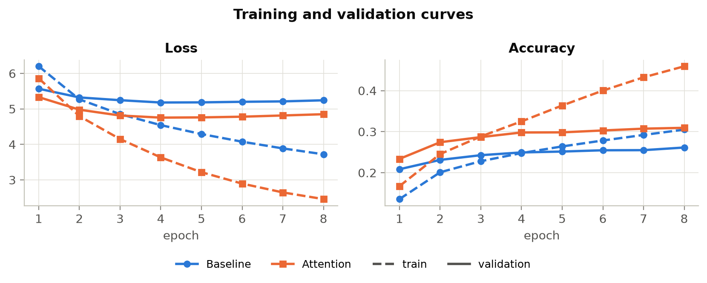
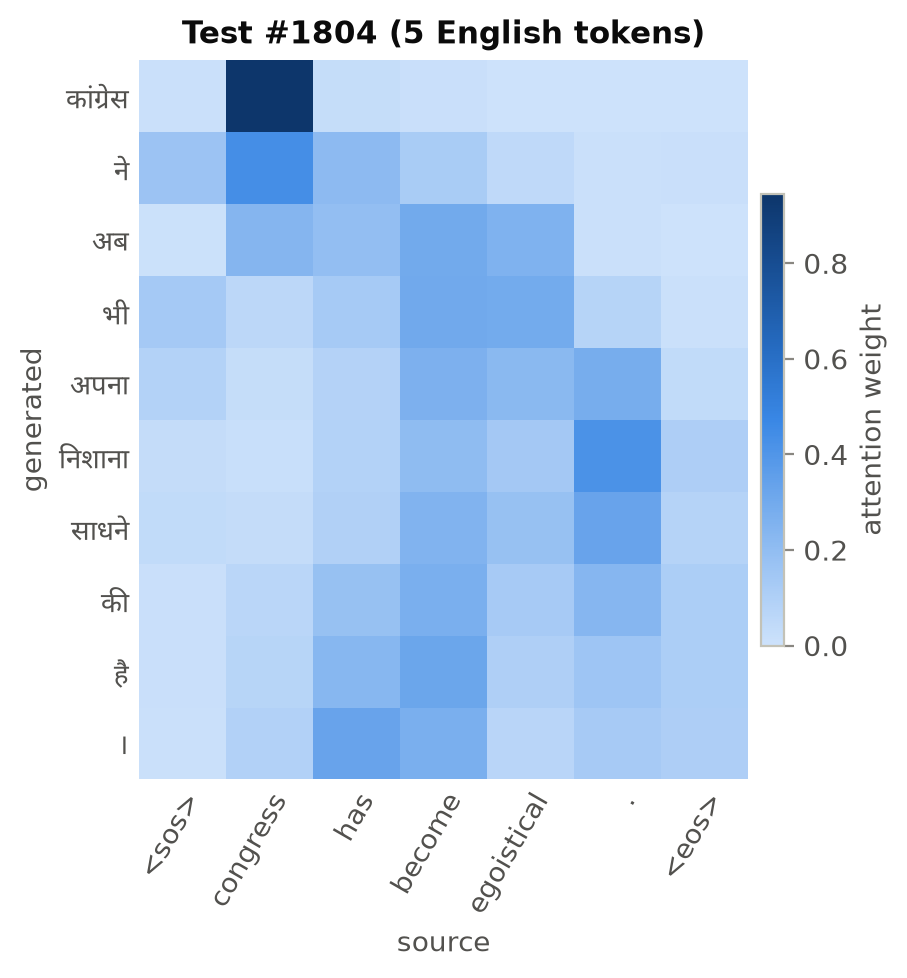
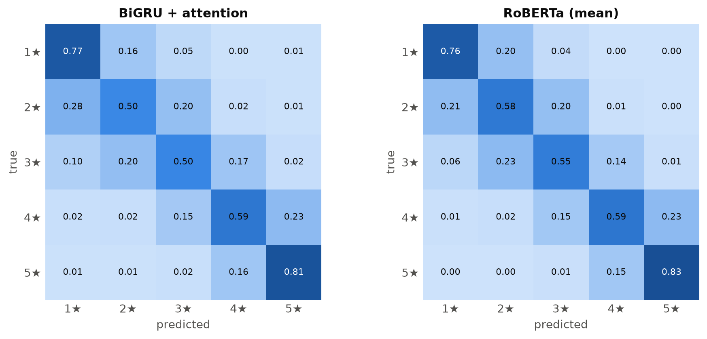
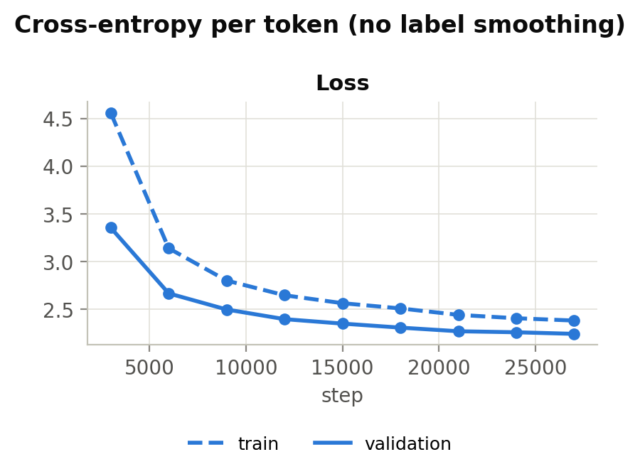
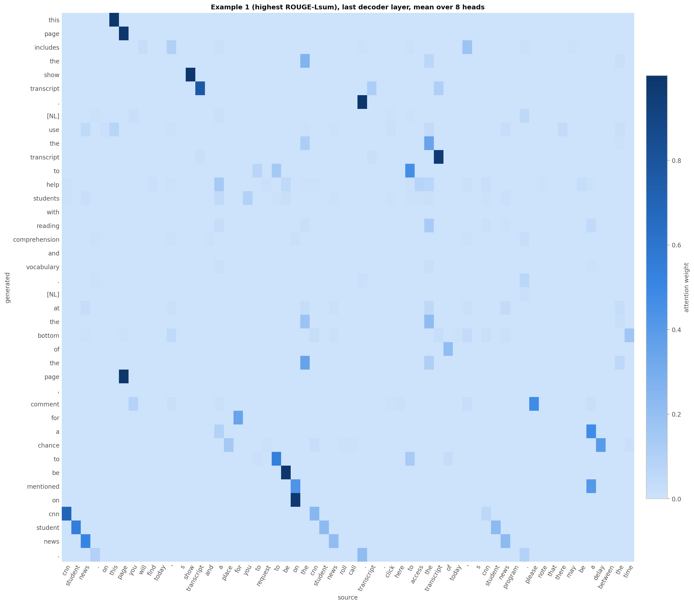
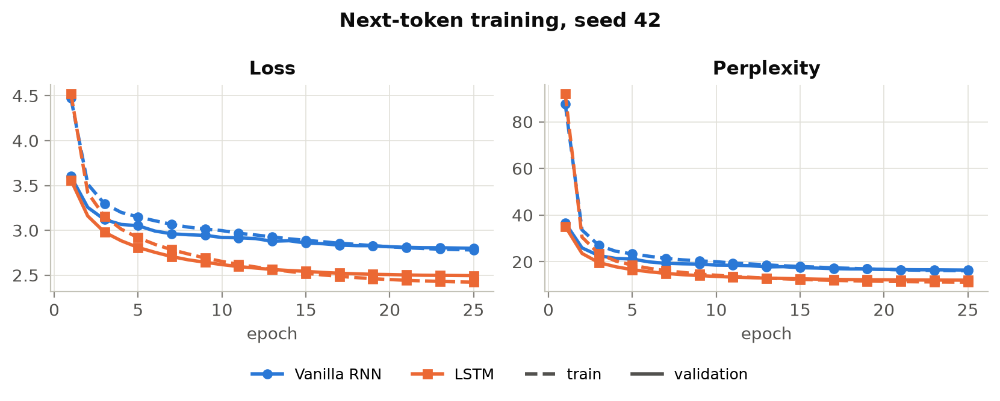
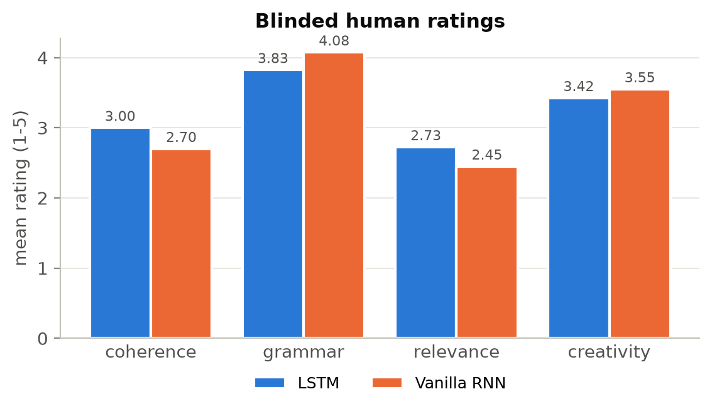

**Group:** Shivam Singh (12342020), Ayush Khelwal (12340430), Keshav Mishra (12341140), Rishi Kharya (12341790), Akshat Gupta (12340160). IIT Bhilai. Repository: <https://github.com/Akshats-git/NLP-Group-Assignment-2>

This report summarises the four systems we built, one per question, with the headline numbers, one or two key figures each, and the conclusions. Each question also has a full report with every table, example and limitation; the combined report points to it and does not repeat it. Every number below is copied from the files in each question's `outputs/results/` folder.

| Question | System | Full report | Run instructions |
|---|---|---|---|
| Q1 | English to Hindi NMT, LSTM encoder-decoder with and without attention | `Question-1/REPORT.md` | `Question-1/README.md` |
| Q2 | Amazon review rating: fine-tuned RoBERTa vs BiGRU with attention pooling | `Question-2/report/report.pdf` | `Question-2/README.md` |
| Q3 | Abstractive summarisation with a Transformer written from scratch | `Question-3/REPORT.pdf` | `Question-3/README.md` |
| Q4 | Plot-Twist Generator: Vanilla RNN vs LSTM story language models | `Question-4/report.md` | `Question-4/README.md` |

# 1. Who did what

| Question | Owner(s) | Main contribution |
|---|---|---|
| Q1 | Rishi Kharya | Data pipeline, both NMT models, attention implementation, heatmaps, error and length analysis, report |
| Q2 | Keshav Mishra | Two preprocessing pipelines, BiGRU, RoBERTa fine-tuning, ablation, evaluation, report |
| Q3 | Shivam Singh, Ayush Khelwal | Transformer from scratch, tokenizer and data, training, ROUGE evaluation, attention heatmaps, report |
| Q4 | Akshat Gupta | Data subset, RNN and LSTM language models, decoding strategies, diversity metrics, human-evaluation tooling, optional LLM baseline, report |
| Shared | everyone | `common/` helpers (seeding, vocab, training, plotting) and their tests; review of each other's pull requests; Ayush, Keshav, Rishi and Shivam rated the blinded Q4 stories |

# 2. Q1: Attention-based English to Hindi NMT

**Setup.** IIT Bombay English-Hindi corpus, 50,000 training pairs (seeded draw from 1,659,083), official dev (514) and test (2,393) sets. Word-level vocabularies built on training data only (English 21,433, Hindi 24,274), maximum length 50 tokens. Both models share a 2-layer bidirectional LSTM encoder (embedding 256, hidden 512). Model A initialises the decoder from the final encoder state only; Model B keeps all encoder states and uses our own Bahdanau attention (`BahdanauAttention` in `models.py`) that returns the weights at every step. Same optimiser, batch size, seed and early-stopping rule for both; parameters differ (38.3M vs 71.9M).

| | Val loss | Val acc | Test token acc | Test BLEU | Test chrF |
|---|---|---|---|---|---|
| A: no attention | 5.180 | 0.249 | 0.243 | 0.55 | 12.3 |
| B: attention | 4.754 | 0.298 | 0.290 | **2.34** | **17.9** |



**By sentence length (test BLEU, A / B).** 6-10 tokens: 0.41 / 2.73; 11-15: 0.48 / 2.74; 16+: 0.57 / 2.26. The 1-5 bucket has only 13 sentences and gives no usable comparison.

**What the heatmaps show.** In 85% of decoding steps the attention peak stays or moves forward through the source. Single content words get sharp attention (about 0.9 for "congress" while writing "कांग्रेस"); function words and phrases are spread over several source tokens (21% of steps have two or more words above 0.2). The mean peak weight is the same (0.277) for generated tokens that appear in the reference and for those that do not, so a high weight does not mean a correct word.



**Conclusions.** Attention clearly helps (BLEU 4.3 times higher, validation loss lower), and keeps its BLEU flat from 6-10 to 16+ tokens, while the baseline sits at the floor in every bucket, so we cannot show a clean decline with length for it. We do not see early words being forgotten as a separate effect. Attention removes the generic, source-independent outputs of the baseline but still fails on out-of-vocabulary words, long-distance structure, and repetition (17.6% of long outputs against 0.5%). Attention maps are a useful diagnostic but not a reliable explanation. **Limitations:** one seed, low absolute BLEU, unequal parameter counts, word-level vocabulary, greedy decoding, error types assigned by hand for 8 sentences.

# 3. Q2: Fine-tuned RoBERTa vs BiGRU for 5-class rating prediction

**Setup.** `SetFit/amazon_reviews_multi_en` (200,000 / 5,000 / 5,000, balanced); titles are re-attached by review id and verified. Two preprocessing pipelines: spaCy tokens, vocabulary of 32,878 types and GloVe 6B 300d for the BiGRU (truncation 200); `RobertaTokenizerFast` with dynamic padding for RoBERTa (truncation 256). The baseline is a 2-layer BiGRU with additive attention pooling (12.0M parameters, embedding frozen for epoch 1). RoBERTa (`roberta-base`, 124.1M) uses a masked mean of the last hidden layer, dropout and a linear head, trained with AdamW, weight decay, linear warm-up and decay, and mixed precision. Both models use seeds 42 and 43; the test set is loaded only in the final evaluation notebook.

| Model | Test accuracy (%) | Test macro-F1 (%) | Test MAE (stars) |
|---|---|---|---|
| BiGRU + attention | 63.30 ± 0.20 | 62.82 ± 0.16 | 0.437 ± 0.002 |
| RoBERTa, mean pooling | **66.31 ± 0.01** | **66.11 ± 0.02** | **0.378 ± 0.001** |
| RoBERTa, first token (ablation) | 66.54 ± 0.17 | 66.36 ± 0.18 | 0.376 ± 0.002 |



**Findings.** RoBERTa is better in every class, most on 2 stars (+4.6 F1) and 3 stars (+4.4). The gain is mostly about error severity: it removes 39% of errors of two or more stars and about half of the 1-vs-5 confusions, while adjacent confusions (especially 4 vs 5 stars) stay at the baseline's level (about 89% of errors are adjacent for both). Qualitatively it handles negation, contrast and typos better; its own failures are concessive 1-star reviews rated one star too high. **Ablation:** mean and first-token pooling are equal within seed noise (0.25 points of test macro-F1 apart); mean pooling varied 2 to 12 times less between seeds. **Limitations:** two seeds, no third epoch for RoBERTa (it peaked at its last checkpoint), pooled confusion matrices.

# 4. Q3: Transformer summariser written from scratch

**Setup.** CNN/Daily Mail 3.0.0, all 287,113 training pairs, validation 13,368, test 11,490. Tokenizer: `bert-base-uncased` WordPiece (the only pre-trained part), lowercased, with an added `[NL]` sentence-break token, one shared vocabulary of 30,523. Truncation: article 400 tokens, summary 128. Model written by hand (attention, feed-forward, positional encodings, encoder and decoder layers, three masks): d_model 512, 8 heads, 4 + 4 layers, d_ff 2048, dropout 0.1, **45.05M parameters**, with a copy switch that lets the model take words from the article. Training: cross-entropy ignoring padding with label smoothing 0.1, Adam (0.9, 0.98, 1e-9) with the paper's warm-up schedule (4,000 steps), fp16, early stopping on validation loss, best checkpoint restored; 6.02 epochs in 3.3 h on 2 x T4. Decoding: greedy up to 128 tokens; greedy with trigram blocking was chosen on validation.

| System (F1 x 100, 11,490 test pairs) | ROUGE-1 | ROUGE-2 | ROUGE-L | ROUGE-Lsum |
|---|---|---|---|---|
| Lead-3 (brief) | 40.06 | 17.48 | 25.02 | 36.36 |
| Greedy | 37.21 | 15.83 | 26.22 | 34.65 |
| **Greedy + trigram blocking (main)** | 38.42 | 16.38 | 26.32 | 35.93 |

ROUGE-L and ROUGE-Lsum are different metrics and are reported separately (`rouge_score`, stemming on).



**Findings.** The model is below Lead-3 on ROUGE-1, ROUGE-2 and ROUGE-Lsum (by 1.63, 1.10 and 0.42 points) and above it on ROUGE-L (+1.30), as the brief predicts for a from-scratch model with limited compute. The gap is explained by the lead bias of news (Lead-3 copies the key sentences word for word), 6 epochs of training from random weights, greedy decoding, and 400-token truncation that cuts 88% of test articles. The report shows six test examples including a repeated phrase, a number not in the article and the lowest-scoring case. **Attention:** the last-layer cross-attention (mean over 8 heads, recorded during generation) puts 46% of its mass on the first 100 article tokens, which are 29% of the tokens the model sees; for 95% of generated words that also occur in the article, the most-attended article token is that same word, so attention often acts as a soft pointer. It shows where information was read from, not that the model understood it.



# 5. Q4: The Plot-Twist Generator

**Setup.** TinyStories (`roneneldan/TinyStories`; the brief's spelling `roneldan` does not exist on the Hub), a documented story-level subset with separate validation and test sets, word-level vocabulary shared by both models. Model A is Embedding, Vanilla RNN, Linear; Model B is Embedding, LSTM, Linear; same data, vocabulary, embedding and hidden sizes, optimiser and 25-epoch budget. Greedy, temperature (0.5, 0.8, 1.2) and top-k decoding were run on 10 prompts, including the five Plot-Twist openings. An optional zero-shot LLM was added as an extra comparison and never replaces the trained models. Two seeds (42, 43); checkpoints and vocabulary are shipped.

| | Vanilla RNN | LSTM |
|---|---|---|
| Parameters | 5,418,886 | 6,601,606 |
| Test perplexity (mean ± std, 2 seeds) | 16.14 ± 0.02 | **11.79 ± 0.09** |
| Training time, 25 epochs | 25.9 min | 39.7 min |
| Repetition rate, greedy | 0.444 | 0.420 |
| Repetition rate, temperature 0.8 | 0.026 | 0.038 |
| Stories that never end within 250 tokens, temperature 0.8 | 17.5% | **8.4%** |



**Human evaluation.** 20 blinded stories rated by four teammates on coherence, grammar, relevance and creativity (1 to 5). The LSTM scored higher on coherence (+0.30) and relevance (+0.28), the RNN on grammar (+0.25) and creativity (+0.12); the overall difference is +0.05 for the LSTM with a 95% interval of [-0.22, +0.36], which is a tie. Rater agreement is near zero (alpha about -0.15), so no difference between models is statistically established.



**Conclusions.** The LSTM models text better (27% lower perplexity) and ends stories more reliably, but it is not less repetitive under sampling and neither model produced a plot twist in any of the five openings. Lower temperature repeats more, higher temperature (1.2) gives the highest Distinct-2 (above real text) together with the worst grammar, so diversity scores cannot certify quality. Top-k 40 was rated more creative than greedy at the cost of coherence. A lower perplexity did not buy a measurably better storyteller. The most common failures are loops under greedy decoding (about 40% of stories), loss of the opening premise, identity drift and stories that never end. **Limitations:** a small corpus and a one-layer recurrent state, an LSTM with 22% more parameters, neither model reached early stopping, a small and noisy human evaluation, and the twist assessment is one non-blind reader's judgement.

# 6. Cross-cutting conclusions

- **Architecture helps where the old design had a bottleneck.** Attention in Q1 removed the fixed-vector bottleneck and made the translations mention the right content; the LSTM in Q4 (gating over a plain recurrence) lowered perplexity by 27%. In both cases the metric gain was clear, but the user-visible quality gain was smaller or harder to demonstrate (low absolute BLEU in Q1, a tie in the human ratings in Q4).
- **Pre-training matters most.** In Q2 a pre-trained RoBERTa beat a well-tuned BiGRU on every class, while in Q3 a from-scratch Transformer stayed below the trivial Lead-3 baseline on three of four ROUGE scores.
- **Attention weights are evidence, not explanation.** In Q1 the peak weight is identical for correct and incorrect tokens; in Q3 attention behaves like a pointer to the words being copied. Both observations support using heatmaps to diagnose a model, and neither supports reading them as proof of why an output is right.
- **Aggregate metrics can disagree with human judgement.** Perplexity (Q4), diversity scores (Q4) and ROUGE (Q3) each measured something real but missed repetition, loss of the premise and unsupported facts, which only reading the outputs revealed.
- **Honest limits.** Seeds were limited (one in Q1 and Q3, two in Q2 and Q4), so small differences (Q2 pooling ablation, Q4 human ratings) are within noise and are reported as such.

# 7. Reproducing the results

```bash
git clone https://github.com/Akshats-git/NLP-Group-Assignment-2.git && cd NLP-Group-Assignment-2
python -m venv .venv && source .venv/bin/activate
pip install -e ".[dev]"                     # shared helpers in common/
pytest -q                                   # tests for common/ and Q4
pip install -r Question-N/requirements.txt  # N = 1, 2, 3 or 4
```

The commands for each question are in `Question-N/README.md`. Q2 and Q3 were trained on Kaggle GPUs (Q2: T4 for the BiGRU, 2 x T4 for RoBERTa; Q3: 2 x T4), Q1 on an RTX 4050 laptop GPU and Q4 on a GTX 1650. Datasets are not included in the submission; each question's code downloads or rebuilds what it needs. Seeds and settings are in each run's `run_info.json`. Only Q4 ships model checkpoints (`Question-4/outputs/checkpoints/` and `vocab.json`), as its brief requires; Q1 to Q3 do not.
